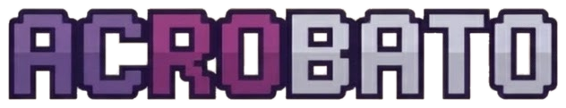

<p align="center">
  
</p>

A retro gaming frontend for desktop Linux and the Steam Deck, packaged as a single AppImage.

AcroBato brings the [Batocera](https://batocera.org) experience to a normal Linux desktop: its
EmulationStation menus, game launcher, controller database and hotkeys, plus RetroArch with
30 bundled cores. It runs as an app on your existing system, so there's no separate OS to install.
Standalone emulators (PCSX2, Dolphin, RPCS3, shadPS4 and more) can be downloaded from inside the app.

## Features

- **One file:** download the AppImage, make it executable, run it.
- **RetroArch with 30 cores** for NES, SNES, Game Boy / Color / Advance, DS, N64, PS1, PSP, GameCube/Wii,
  Mega Drive/Genesis, Master System, Game Gear, Saturn, Dreamcast, PC Engine, Neo Geo, arcade, DOS,
  Amiga, MSX, 3DO, Lynx, WonderSwan, Atari 2600/7800, Vectrex and more.
- **Emulator downloads:** *Updates & Downloads > Content Downloader* installs standalone emulators
  from their official releases (checksum-verified where the project publishes checksums) or Flathub.
- **Nintendo Switch, Switch 2 and PlayStation 5** (systems Batocera doesn't have), with emulators
  from the Content Downloader:
  - Switch: Eden (default), Ryujinx (Flathub) and Lichii
  - Switch 2: Eglantine (default) and Lichii (both very experimental); games as `.nup`, `.nx` or `.sw2` folders
  - PS5: KytyPS5 (very experimental)

  Pick the emulator per game in *Advanced game options*. Eden, Eglantine and Lichii also have graphics,
  memory and system settings there. Switch keys and firmware go in `bios/switch/` (Switch 2 needs none), and
  "Open <emulator>" entries in each system's list open the emulator's own window.
- **Controllers:** Batocera's controller database (about 340 pads). Steam's virtual controllers
  are supported in Game Mode and when launched from Steam.
- **Hotkeys:** Hotkey + Start quits a game, Hotkey + Y / X saves / loads a state, and more
  (Batocera's hotkey set). On the Steam Deck the hotkey is Select.
- **Scrapers:** LaunchBox, libretro thumbnails and GameTDB need no account. SteamGridDB uses your
  own free API key.
- **Runs on:** Ubuntu 22.04+, Linux Mint 21+, Debian 12+, Fedora, Arch, SteamOS, Bazzite,
  openSUSE Tumbleweed and other distributions with glibc 2.35 or newer.

## Getting started

1. Download `AcroBato-x86_64.AppImage` from the [Releases](../../releases) page.
2. Make it executable: `chmod +x AcroBato-x86_64.AppImage` (or *Properties > Allow executing*).
3. Run it. On a Steam Deck, add it to Steam as a non-Steam game to use it in Game Mode.

Your games, saves and settings live in `~/.local/share/acrobato/`:

| Folder | What goes there |
|---|---|
| `roms/<system>/` | Your games. Each system folder has an `_info.txt` listing the file types and BIOS files it needs. |
| `bios/` | BIOS files (see each system's `_info.txt`). |
| `saves/`, `screenshots/` | Saves, save states and screenshots. |
| `emulators/` | Emulators installed from the Content Downloader. |

AcroBato includes **no games and no BIOS files**. Use your own legally obtained copies.

## Building from source

AcroBato is built on a Linux host with [distrobox](https://distrobox.it). Everything is compiled
inside an Ubuntu 22.04 container, so the AppImage runs on glibc 2.35 and newer.

```bash
distrobox create -Y -n esbuild -i docker.io/library/ubuntu:22.04
git clone https://github.com/batocera-linux/batocera.linux.git ~/rbl/src/batocera.linux   # Batocera sources (launcher, data, recipes)
git -C ~/rbl/src/batocera.linux checkout 23d3fcfea8a9a31b045d188ea39806ef01251efb   # the version AcroBato is built against
distrobox enter esbuild -- bash scripts/build-es.sh           # SDL2/SDL3 with Batocera's patches, EmulationStation
distrobox enter esbuild -- bash scripts/build-ffmpeg-min.sh   # minimal LGPL FFmpeg
distrobox enter esbuild -- bash scripts/build-retroarch.sh    # RetroArch (Batocera's version and patches)
distrobox enter esbuild -- bash scripts/build-cores.sh        # the 30 cores, at Batocera's versions
distrobox enter esbuild -- bash scripts/build-appdir.sh       # assemble the AppDir (launcher, data, licenses)
bash scripts/pack-appimage.sh                                 # -> ~/rbl/out/AcroBato-x86_64.AppImage
```

Work files go to `~/rbl` (override with `WORK=`). `scripts/test-distro.sh` checks an extracted
AppImage on another distribution (inside a distrobox container): missing libraries, ES start,
and a RetroArch game launch.

### How it works

- `patches/emulationstation/` and `scripts/apply-es-*.py` adapt Batocera's EmulationStation:
  relocatable paths instead of Batocera's fixed `/userdata`, branding, scrapers, and starting
  with an empty library.
- `scripts/relocate-launcher.py` adapts Batocera's Python launcher (`batocera-launch`) to run
  from the AppImage and the user's home folder, plus desktop fixes (D-Bus session bus, hotkeys via
  RetroArch network commands, no root needed for input devices).
- `packaging/AppRun` sets up the environment and the data folder, and starts the hotkey daemon
  and EmulationStation.
- `packaging/store/` is the Content Downloader backend. `packaging/scraper/` is the
  LaunchBox / libretro / GameTDB scraper helper.
- `compat/bin/` holds desktop stand-ins for Batocera OS commands.

## Credits and licenses

AcroBato is built on the work of the [Batocera](https://batocera.org) team (EmulationStation fork,
launcher, controller database, recipes), [RetroArch / libretro](https://www.libretro.com) and the
authors of every bundled emulator core. Inspired by [RetroBat](https://www.retrobat.org).
AcroBato is not affiliated with or endorsed by these projects.

AcroBato's own code (build scripts, patches, launcher integration, scrapers, downloader) is licensed
under **GPL-3.0-or-later** (see [LICENSE](LICENSE)). Bundled components keep their own licenses. See
[THIRD-PARTY-NOTICES.md](THIRD-PARTY-NOTICES.md) and `usr/share/acrobato/licenses/` inside the AppImage.
Some bundled cores (Snes9x, Genesis Plus GX, PicoDrive, FinalBurn Neo, Opera) are licensed for
non-commercial use only, so AcroBato is and must remain free.
